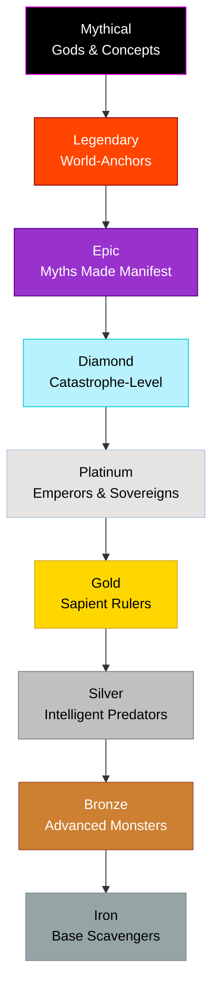

---
tags:
  - index
  - mechanics
---
# Master Bloodline Hierarchy

> [!abstract]
> This index organizes all currently documented dragon species by their Bloodline Rank, from the weakest Iron-1 scavengers to the reality-warping Mythical entities. 

## The Draconic Pyramid

## Iron Tier
> *Base-level beasts. Extremely common in the wild. Cannot speak, purely instinct-driven.*
- **Iron-1**: [[Ashscale Drake]] (Fire), [[Breezetail Wyvern]] (Storm)
- **Iron-2**: [[Mosscrest Drake]] (Nature), [[Soot-Lung Drake]] (Forge), [[Spark-Wing Wyvern]] (Aurora), [[Glass-Scale Drake]] (Mirror), [[Vial-Wyrm]] (Bio-Alchemy Hybrid)
- **Iron-3**: [[Ironhide Mountain Drake]] (Earth), [[Frostburrow Drake]] (Frost), [[Mud-Crawler Wyrm]] (Fungal), [[Mirecrown Wyrm]] (Fungal), [[Rune-Etched Drake]] (Rune), [[Tidecoil Wyrm]] (Ocean), [[Verdant Wing Dragon]] (Nature), [[Golden-Sap Dragon]] (Amber), [[Echo Wyvern]] (Chorus), [[Boiler Drake]] (Thermal Hybrid), [[Lodestone Drake]] (Lodestone Hybrid), [[Rust-Fin Drake]] (Trench Hybrid)

## Bronze Tier
> *Advanced monsters. Capable of basic pack tactics and significant elemental damage.*
- **Bronze-1**: [[Flamehorn Dragon]] (Fire), [[Thunderjaw Wyvern]] (Storm), [[Frostscale Drake]] (Frost), [[Verdant Drake]] (Nature), [[Coal-Heart Drake]] (Forge), [[Neon-Crest Wyvern]] (Aurora), [[Shard-Glass Drake]] (Mirror), [[Ember-Bark Wyrm]] (Magma-Root Hybrid)
- **Bronze-2**: [[Magmaheart Dragon]] (Fire), [[Whisperwing Drake]] (Dream), [[Mirecrown Wyrm]] (Fungal), [[Rune-Etched Drake]] (Rune), [[Tidecoil Wyrm]] (Ocean), [[Verdant Wing Dragon]] (Nature), [[Golden-Sap Dragon]] (Amber), [[Echo Wyvern]] (Chorus), [[Boiler Drake]] (Thermal Hybrid), [[Lodestone Drake]] (Lodestone Hybrid), [[Rust-Fin Drake]] (Trench Hybrid)
- **Bronze-3**: [[Infernal Horn Dragon]] (Fire), [[Tempest Wyvern]] (Storm), [[Adamant Ridge Dragon]] (Earth), [[Abysswater Wyrm]] (Ocean), [[Caustic-Rune Drake]] (Bio-Alchemy Hybrid)

## Silver Tier
> *The threshold of true intelligence. Highly prized by mid-level Tamers.*
- **Silver-1**: [[Moonfang Dragon]] (Frost), [[Azure Flame Dragon]] (Noctis), [[Dreamveil Dragon]] (Dream), [[Gravebloom Drake]] (Life/Death), [[Blast-Furnace Dragon]] (Forge), [[Plasma-Wing Wyvern]] (Aurora), [[Prism-Core Dragon]] (Mirror), [[Geyser Wyrm]] (Thermal Hybrid), [[Wildfire Drake]] (Magma-Root Hybrid), [[Twilight Wyvern]] (Eclipse Hybrid), [[Phantasm Drake]] (Mirage Hybrid)
- **Silver-2**: [[Thundercrest Dragon]] (Storm), [[Azurewing Flame Dragon]] (Noctis), [[Sigil Dragon]] (Rune), [[Deepsea Leviathan Wyrm]] (Ocean), [[Fossil-Amber Dragon]] (Amber), [[Resonance Dragon]] (Chorus), [[Magnetic Wyvern]] (Lodestone Hybrid), [[Trench-Boiler Wyrm]] (Trench Hybrid)
- **Silver-3**: [[Stormheart Dragon]] (Storm), [[Noctis Azurewing Wyrm]] (Noctis - *Night*), [[Plaguebloom Dragon]] (Fungal), [[Brass-Wing Dragon]] (Forge), [[Obsidian-Glass Wyrm]] (Multi-Hybrid Anomaly)

## Gold Tier
> *Sapient beings capable of speech and Humanoid Manifestation. Rulers of large territories.*
- **Gold-1**: [[Thunder Emperor Dragon]] (Storm), [[Noctis Starfire Dragon]] (Noctis), [[Abyssal Azure Dragon]] (Noctis), [[Azure Nightwing Dragon]] (Noctis), [[Frostmoon Dragon]] (Frost), [[Oneiric Oracle Dragon]] (Dream), [[Nethergarden Dragon]] (Life/Death), [[Ionosphere Dragon]] (Aurora), [[Refraction Wing Dragon]] (Mirror), [[Pyrophyte Dragon]] (Magma-Root Hybrid), [[Bio-Hazard Dragon]] (Bio-Alchemy Hybrid), [[Kaleidoscope Wyrm]] (Mirage Hybrid)
- **Gold-2**: [[Inferno Sovereign Dragon]] (Fire), [[Titanheart Dragon]] (Earth), [[Grimoire Dragon]] (Rune), [[Molten-Core Siege Dragon]] (Forge), [[Thermal Sovereign]] (Thermal Hybrid), [[Umbral-Flare Dragon]] (Eclipse Hybrid)
- **Gold-3**: [[Eclipse Frost Dragon]] (Frost), [[Rot-Crown Dragon]] (Fungal), [[Ancient Verdant Dragon]] (Nature)

## Platinum Tier
> *Emperor-level dragons. Often the heads of Dragon Houses or minor kingdoms.*
- **Platinum-1**: [[Imperial Flame Dragon]] (Fire), [[Storm Tyrant Dragon]] (Storm), [[Abyssal Ocean Dragon]] (Ocean), [[Amber Tomb Dragon]] (Amber), [[Choir Sovereign Dragon]] (Chorus), [[Mirrored Sovereign]] (Mirror), [[Polarity Dragon]] (Lodestone Hybrid), [[Tremor-Cloud Dragon]] (Cataclysm Hybrid)
- **Platinum-2**: [[Sunscale Imperial Dragon]] (Fire), [[Celestial Nightwing Dragon]] (Noctis), [[Nightwinter Dragon]] (Frost), [[Mountain-Crown Titan Dragon]] (Earth), [[Cyclekeeper Dragon]] (Life/Death), [[Library Core Dragon]] (Rune), [[Furnace-Heart Sovereign]] (Forge), [[Bathypelagic Siege Dragon]] (Trench Hybrid), [[Mirage Sovereign]] (Mirage Hybrid)
- **Platinum-3**: [[Abyssflame Dragon]] (Fire), [[Void-Azure Devourer]] (Noctis), [[Worldroot Dragon]] (Nature), [[Fractal Glass Sovereign]] (Mirror), [[Petrified Amber Titan]] (Amber), [[World-Engine Core Dragon]] (Forge), [[Necrotic Spore Sovereign]] (Fungal), [[Alchemical Plague-Core]] (Bio-Alchemy Hybrid)

## Diamond Tier
> *Catastrophe-level entities. A single Diamond dragon can wage war against a humanoid empire.*
- **Diamond-1**: [[Celestial Solar Dragon]] (Fire), [[Heavenly Storm Dragon]] (Storm), [[Ocean Sovereign Leviathan]] (Ocean), [[Labyrinth Glass Dragon]] (Mirror), [[World-Ash Dragon]] (Magma-Root Hybrid), [[World-Trench Leviathan]] (Trench Hybrid)
- **Diamond-2**: [[Eternal Winter Dragon]] (Frost), [[Symphony Dragon]] (Chorus), [[Abyssal Firestorm Dragon]] (Fire), [[Event Horizon Devourer]] (Noctis), [[Eclipse Sovereign]] (Eclipse Hybrid)
- **Diamond-3**: [[Sun-Crowned Dragon Emperor]] (Fire), [[Heavenbreaker Thunder Dragon]] (Storm), [[Omniscience Construct Dragon]] (Rune), [[Eternal Life Dragon]] (Nature), [[Tectonic Hurricane Sovereign]] (Cataclysm Hybrid)

## Epic Tier
> *Dragons whose very existence alters the laws of physics around them.*
- [[World-Forge Core Dragon]] (Forge)
- [[Endless Night Dragon]] (Noctis)
- [[Dragon of Infinite Reflections]] (Mirage Hybrid)

## Legendary Tier
> *Demi-gods. Ancient beings worshipped by entire species. Only one of each exists.*
- [[Dragon of the First Flame]] (Fire)
- [[Dragon of the First Origin]] (Pure)
- [[Word of Law Dragon]] (Rune)
- [[Dragon of the Dying Sun]] (Eclipse Hybrid)

## Mythical Tier
> *The apex of the System. They embody the fundamental concepts of reality.*
- [[The Great Ancestor]] (Genesis)
- [[Planet-Breaker Dragon]] (Cataclysm Hybrid)
