---
tags:
  - mechanics
  - bloodlines
---
# Bloodline Ranks

Bloodline Rank is the fundamental measure of a dragon's inherited potential, biological quality, and position in the draconic hierarchy. It is completely independent of [[Level]].

```mermaid
graph BT
    subgraph Mythic Tier
        M[Mythical]
    end
    
    subgraph Legendary Tier
        L[Legendary]
    end
    
    subgraph Epic Tier
        E[Epic]
    end
    
    subgraph Diamond Tier
        D1[Diamond-1] --> D2[Diamond-2] --> D3[Diamond-3]
    end
    
    subgraph Platinum Tier
        P1[Platinum-1] --> P2[Platinum-2] --> P3[Platinum-3]
    end
    
    subgraph Gold Tier
        G1[Gold-1] --> G2[Gold-2] --> G3[Gold-3]
    end
    
    subgraph Silver Tier
        S1[Silver-1] --> S2[Silver-2] --> S3[Silver-3]
    end
    
    subgraph Bronze Tier
        B1[Bronze-1] --> B2[Bronze-2] --> B3[Bronze-3]
    end
    
    subgraph Iron Tier
        I1[Iron-1] --> I2[Iron-2] --> I3[Iron-3]
    end

    I3 --> B1
    B3 --> S1
    S3 --> G1
    G3 --> P1
    P3 --> D1
    D3 --> E
    E --> L
    L --> M
    
    classDef iron fill:#95a5a6,stroke:#7f8c8d,color:#000
    classDef bronze fill:#cd7f32,stroke:#a0522d,color:#fff
    classDef silver fill:#c0c0c0,stroke:#808080,color:#000
    classDef gold fill:#ffd700,stroke:#daa520,color:#000
    classDef plat fill:#e5e4e2,stroke:#b0c4de,color:#000
    classDef diamond fill:#b9f2ff,stroke:#00ced1,color:#000
    classDef epic fill:#9932cc,stroke:#4b0082,color:#fff
    classDef leg fill:#ff4500,stroke:#8b0000,color:#fff
    classDef myth fill:#000000,stroke:#ff00ff,color:#fff
    
    class I1,I2,I3 iron
    class B1,B2,B3 bronze
    class S1,S2,S3 silver
    class G1,G2,G3 gold
    class P1,P2,P3 plat
    class D1,D2,D3 diamond
    class E epic
    class L leg
    class M myth
```

