---
tags:
  - mechanics
  - affinities
---
# Affinity System

Affinities dictate the type of mana a dragon can process, command, and embody. A dragon cannot casually acquire an unrelated high-order affinity (e.g., a pure Fire dragon cannot become a Time dragon simply by eating a clock artifact). Resources strengthen or awaken *compatible* ancestry.

## Affinity Hierarchy Map

```mermaid
graph TD
    %% Foundational
    subgraph Foundational
        Fi[Fire]
        Wa[Water]
        Ea[Earth]
        Wi[Wind]
        Ic[Ice]
        Li[Lightning]
        Me[Metal]
        Na[Nature]
        Po[Poison]
        Sa[Sand]
        Cr[Crystal]
        So[Sound]
    end

    %% Advanced Elemental
    subgraph Advanced Elemental
        Ma[Magma]
        St[Storm]
        Fr[Frost]
        Mi[Mist]
        As[Ash]
        La[Lava]
        Pl[Plasma]
        Mg[Magnetism]
        Ac[Acid]
        Gl[Glass]
        Wo[Wood]
        Sw[Swamp]
        Pr[Pressure]
    end

    %% Higher
    subgraph Higher Affinities
        Lg[Light]
        Da[Darkness]
        Bl[Blood]
        Lu[Lunar]
        Sl[Solar]
        Se[Stellar]
        Gr[Gravity]
        Su[Soul]
        Dr[Dream]
        Wr[War]
        Pm[Primal]
        Au[Authority]
    end

    %% Conceptual
    subgraph Conceptual & Rare
        Lf[Life]
        De[Death]
        Sp[Space]
        Ti[Time]
        Vo[Void]
        Ch[Chaos]
        Cx[Creation]
        Dx[Destruction]
    end

    %% Some basic connections (Illustrative)
    Fi --> Ma
    Fi --> As
    Fi --> Pl
    Ea --> Ma
    Ea --> Mg
    Ea --> Cr
    Wa --> Pr
    Wa --> Mi
    Wa --> Ic
    Ic --> Fr
    Wi --> St
    Li --> St
    Li --> Pl
    Na --> Wo
    Na --> Sw
    Po --> Sw
    Po --> Ac
    Sa --> Gl
    Fi --> Gl
    
    %% Higher Connections
    Fi -.-> Sl
    Lg -.-> Sl
    Lg -.-> Lu
    Da -.-> Lu
    Da -.-> Vo
    Lg -.-> Su
    Su -.-> Dr
    Ea -.-> Gr
    Se -.-> Gr
    Sp -.-> Vo
    Sp -.-> Gr
    Bl -.-> Lf
    Na -.-> Lf
    Po -.-> De
    
    %% Conceptual Connections
    Lf === Cx
    De === Dx
    Vo === Ch
    Sp === Ti
```

## Categories

### Foundational Affinities
The building blocks of most biological draconic life:
*Fire, Water, Earth, Wind, Ice, Lightning, Metal, Nature, Poison, Sand, Crystal, Sound.*

### Advanced Elemental Affinities
Formed from extreme environments or the combination of foundational elements:
*Magma, Storm, Frost, Mist, Ash, Lava, Plasma, Magnetism, Acid, Glass, Wood, Swamp, Pressure.*

### Higher Affinities
Tied to celestial bodies, abstract concepts, or the fundamental forces of the world. Dragons with these are often rulers or apex predators:
*Light, Darkness, Blood, Lunar, Solar, Stellar, Gravity, Soul, Dream, War, Primal, Authority.*

### Extremely Rare / Conceptual Affinities
Manifestations of universal laws. Almost exclusive to Epic, Legendary, or Mythical dragons:
*Life, Death, Space, Time, Void, Chaos, Creation, Destruction.*
