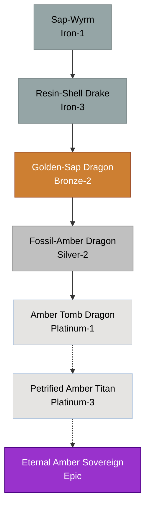

# Amber / Resin Family

## Summary
> [!abstract]
> A swamp and ancient forest lineage that secretes a thick, magical resin that hardens into impenetrable amber. Used as defensive guardians and trappers.

## Ancestry & Origins
An offshoot of the Nature lineage that sacrificed offensive mobility for absolute defense and the ability to preserve food/prey perfectly in sap.

## Typical Affinities
Nature, Earth, Water, Poison (minor).

## Body Type Trends
Squat, heavy Drakes and Shell Dragons. They often lack wings entirely, preferring to root themselves in place.

## Evolution Tree

## Branch Explanations
This is a naturally limited bloodline. The physical limitations of being encased in hardened amber prevent them from accessing higher-order conceptual magic. Their ultimate natural form, the Amber Tomb Dragon, is practically immortal but completely immobile. Extreme age and geospheric pressure can mutate it further into a Petrified Amber Titan, regaining mobility.

## Evolutionary Ceilings
- **Natural Ceiling**: Silver-2 (Fossil-Amber Dragon)
- **Mutation Ceiling**: Epic (Eternal Amber Sovereign)
- **Transcendent Ceiling**: Epic
