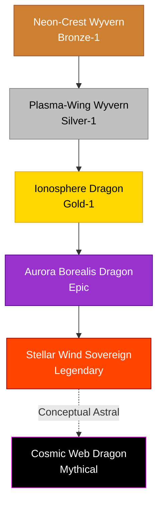

# Aurora / Cosmic Family

## Summary
> [!abstract]
> High-altitude, ethereal dragons that swim through the planet's magnetosphere and atmospheric currents. They feed on solar radiation and cosmic winds.

## Ancestry & Origins
Dragons that migrated higher into the atmosphere than any other, adapting their bodies to become lighter than air and sustaining themselves purely on starlight and magnetic fields.

## Typical Affinities
Light, Wind, Stellar, Plasma, Magnetism.

## Body Type Trends
Ethereal Amphipteres and Wyverns. Their wings are often composed purely of hard-light or plasma rather than physical membrane.

## Evolution Tree

## Branch Explanations
The jump from Gold-1 directly to Epic is due to the extreme rarity of dragons successfully leaving the planet's atmosphere to consume true stellar winds. Most die trying.

## Evolutionary Ceilings
- **Natural Ceiling**: Gold-1 (Ionosphere Dragon)
- **Mutation Ceiling**: Epic (Aurora Borealis Dragon)
- **Transcendent Ceiling**: Mythical (Cosmic Web Dragon)
