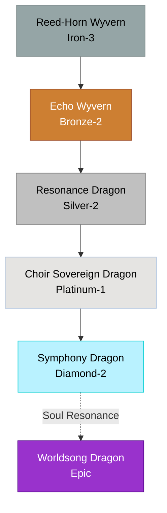

# Chorus / Resonance Family

## Summary
> [!abstract]
> Wyverns and true dragons with hollow, flute-like horns and specialized vocal cords that manipulate ambient mana through sonic resonance. Highly cultured.

## Ancestry & Origins
Dragons that developed in dense, echo-heavy canyon networks where sound manipulation was necessary for communication and hunting over vast distances.

## Typical Affinities
Sound, Wind, Soul, Mind.

## Body Type Trends
Wyverns and feathered True Dragons. Their scales are designed to vibrate, acting as amplifiers.

## Evolution Tree

## Branch Explanations
These dragons are highly social. A single Reed-Horn Wyvern is weak, but a flock can shatter stone with synchronized cries. A Worldsong Dragon is capable of rewriting reality through the fundamental frequency of the world.

## Evolutionary Ceilings
- **Natural Ceiling**: Platinum-1 (Choir Sovereign Dragon)
- **Mutation Ceiling**: Epic (Worldsong Dragon)
- **Transcendent Ceiling**: Epic
