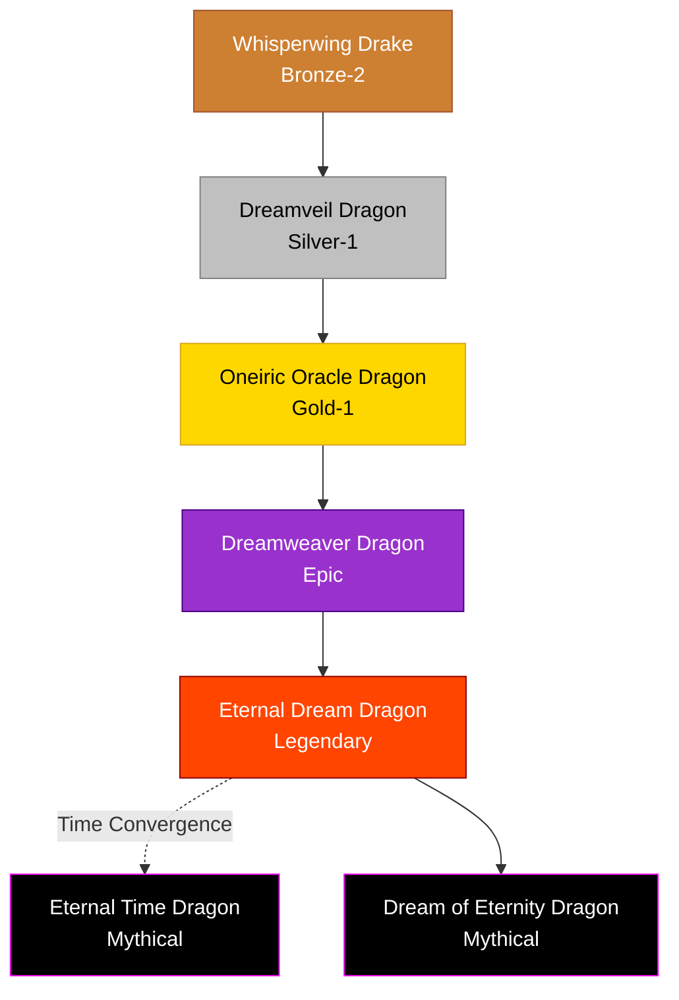

# Dream / Mind / Oracle Family

## Summary
> [!abstract]
> Enigmatic and rarely seen dragons that interact with consciousness, probability, and subjective reality rather than physical elements.

## Ancestry & Origins
Evolved in regions of extreme mana-saturation where the boundaries between the physical world and the astral/soul realms grew thin.

## Typical Affinities
Sound, Mind, Dream, Soul, Time (Subjective).

## Body Type Trends
Delicate Drakes that transition into semi-ethereal True Dragons, often possessing multiple eyes, sensory organs, or continuous hypnotic patterns on their scales.

## Evolution Tree

## Branch Explanations
The gap between Gold-1 (Oneiric Oracle) and Epic (Dreamweaver) is immense. Many Oracles never evolve further, naturally capped by their inability to comprehend the subjective reality required to weave true dreams.

## Evolutionary Ceilings
- **Natural Ceiling**: Gold-1 (Oneiric Oracle)
- **Mutation Ceiling**: Legendary (Eternal Dream)
- **Transcendent Ceiling**: Mythical
