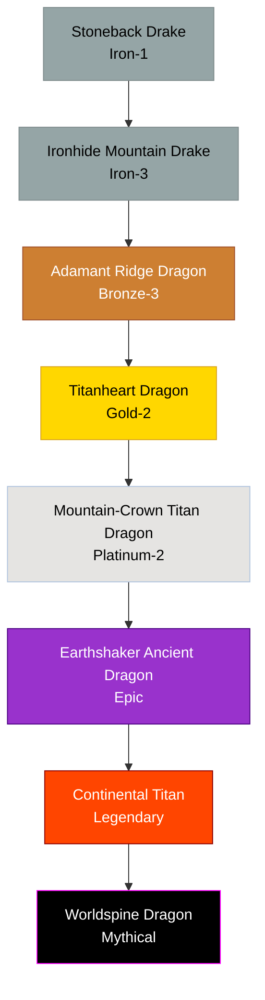

# Earth / Metal / Titan Family

## Summary
> [!abstract]
> Lineages defined by extreme density, unyielding defense, and eventual mastery over gravity and tectonic forces. They are the siege engines of the draconic world.

## Ancestry & Origins
Creatures of deep caves and mountain cores, consuming minerals to reinforce their scales until their biology blurred with geology.

## Typical Affinities
Earth, Metal. High tiers unlock War, Gravity, and eventually Creation/World-Anchor authorities.

## Body Type Trends
Heavily armored Drakes that transition into massive True Dragons, and finally continent-sized Titan Dragons. They are notoriously slow fliers (if they fly at all) until they unlock Gravity affinities.

## Evolution Tree

## Evolutionary Ceilings
- **Natural Ceiling**: Gold-2 (Titanheart Dragon)
- **Mutation Ceiling**: Epic (Earthshaker Ancient Dragon)
- **Transcendent Ceiling**: Mythical

## Rare Resources
- World-core fragments
- Gravity-dense ores
- Primordial metal veins
