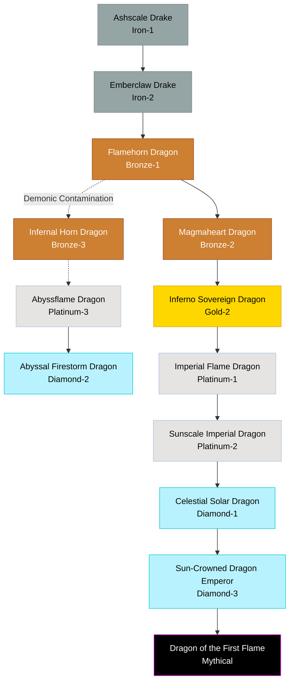

# Fire / Imperial Family

## Summary
> [!abstract]
> The most well-known progression of draconic power, moving from simple volcanic scavengers to the highest authorities of flame and command.

## Ancestry & Origins
Rooted in ancient geological heat and the concept of rule by might.

## Typical Affinities
Fire, Ash, Earth, Magma. Later evolutions branch into Demonic, Solar, Light, Authority, and ultimately Conceptual Creation.

## Body Type Trends
Starts as Ground Drakes (wingless, terrestrial), transitioning into True Dragons (winged), and finally taking on Imperial and Emperor Dragon forms characterized by literal or magical crowns of horn and flame.

## Evolution Tree

## Evolutionary Ceilings (Base Lineage)
- **Natural Ceiling**: Gold-2 (Inferno Sovereign)
- **Mutation Ceiling**: Diamond-2 (Abyssal Firestorm)
- **Transcendent Ceiling**: Mythical (Dragon of the First Flame)

## Rare Resources
- Magma-core crystals
- Solar drops
- Imperial authority seals
