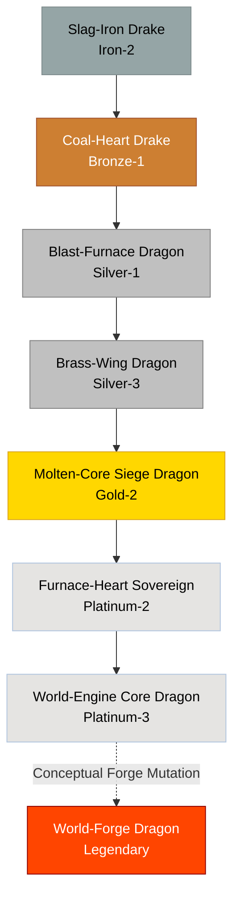

# Forge / Automaton Family

## Summary
> [!abstract]
> A heavy, industrial lineage born in mineral-rich volcanic regions. They consume raw ore and coal, acting as living furnaces. Their scales naturally interlock like gears or plate armor.

## Ancestry & Origins
Originally an offshoot of the Earth/Titan family that adapted to consume extreme heat and metal simultaneously. They were highly prized by ancient dwarf-equivalents and human forge-masters, leading to centuries of selective breeding.

## Typical Affinities
Metal, Fire, Magma, Smoke.

## Body Type Trends
Starts as squat, heavy Drakes. The mid-tiers develop into thickly armored True Dragons that struggle to fly but excel at siege warfare. 

## Evolution Tree

## Branch Explanations
This family naturally stops at the Platinum tier. Because they rely heavily on physical metal and heat, they struggle to touch the conceptual affinities required for Diamond and Epic evolutions unless heavily mutated into a "World-Forge" concept.

## Evolutionary Ceilings
- **Natural Ceiling**: Platinum-2 (Furnace-Heart Sovereign)
- **Mutation Ceiling**: Platinum-3 (World-Engine Core Dragon)
- **Transcendent Ceiling**: Legendary (World-Forge Dragon)

## Rare Resources
- Deep-mantle coal
- Refined Orichalcum
- Fire-mana geode hearts
