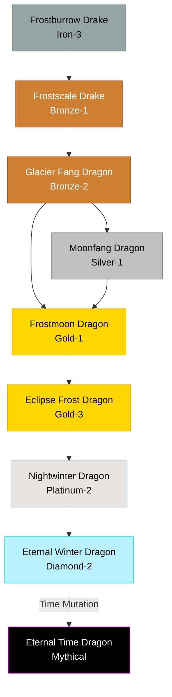

# Frost / Lunar Family

## Summary
> [!abstract]
> Lineages defined by extreme cold, nocturnal habits, and eventual manipulation of time and stasis through frozen eternity.

## Ancestry & Origins
Creatures of the deepest tundras and polar peaks that began absorbing lunar mana to survive the longest nights.

## Typical Affinities
Ice, Earth, Light, Lunar. The highest tiers touch Darkness and Time.

## Body Type Trends
Starts as heavily armored Drakes, transitioning into True Dragons and eventually Ancient Dragons capable of suspending themselves in cryostasis for centuries.

## Evolution Tree

## Branch Explanations
The Time-affinity mutation at the Diamond-2 stage is extraordinarily rare, requiring the dragon to freeze the concept of its own biological clock.

## Evolutionary Ceilings
- **Natural Ceiling**: Diamond-2 (Eternal Winter Dragon)
- **Mutation Ceiling**: Mythical (Eternal Time Dragon)
- **Transcendent Ceiling**: Mythical
