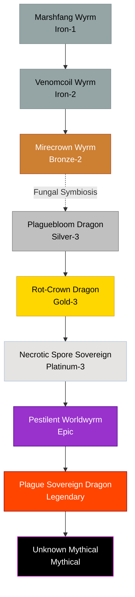

# Fungal / Plague Family

## Summary
> [!abstract]
> A horrifying, often highly restricted lineage that starts as simple swamp predators and evolves into civilization-ending ecological catastrophes.

## Ancestry & Origins
Swamp wyrms that entered into deep symbiosis with parasitic mana-fungi.

## Typical Affinities
Water, Poison, Nature, Disease, Death, Life (Twisted).

## Body Type Trends
Wyrms and Abyssal Dragons. They rarely develop true wings, instead floating on miasma or growing massive, grotesque fungal structures.

## Evolution Tree

## Evolutionary Ceilings
- **Natural Ceiling**: Silver-3 (Plaguebloom Dragon)
- **Mutation Ceiling**: Platinum-3 (Necrotic Spore Sovereign)
- **Transcendent Ceiling**: Mythical

## Ecology
Usually destroyed on sight by advanced civilizations due to the threat of exponential pathogenic spread.
