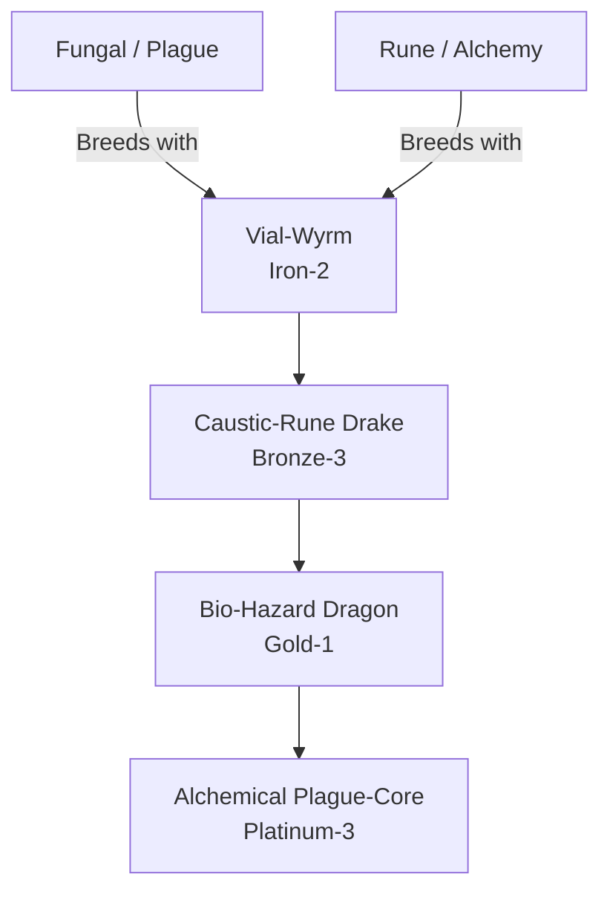

# Bio-Alchemy / Toxic-Rune Family (Hybrid)

## Summary
> [!abstract]
> A horrifying fusion of Fungal plague and Rune magic. These dragons engineer their own sentient diseases using alchemical magic.

## Ancestry & Origins
**Breeding Recipe**: Fungal + Rune. Often created accidentally in ruined alchemist towers.

## Evolution Tree

## Evolutionary Ceilings
- **Natural Ceiling**: Gold-1 (Bio-Hazard Dragon)
- **Mutation Ceiling**: Platinum-3 (Alchemical Plague-Core)
- **Transcendent Ceiling**: Platinum-3
