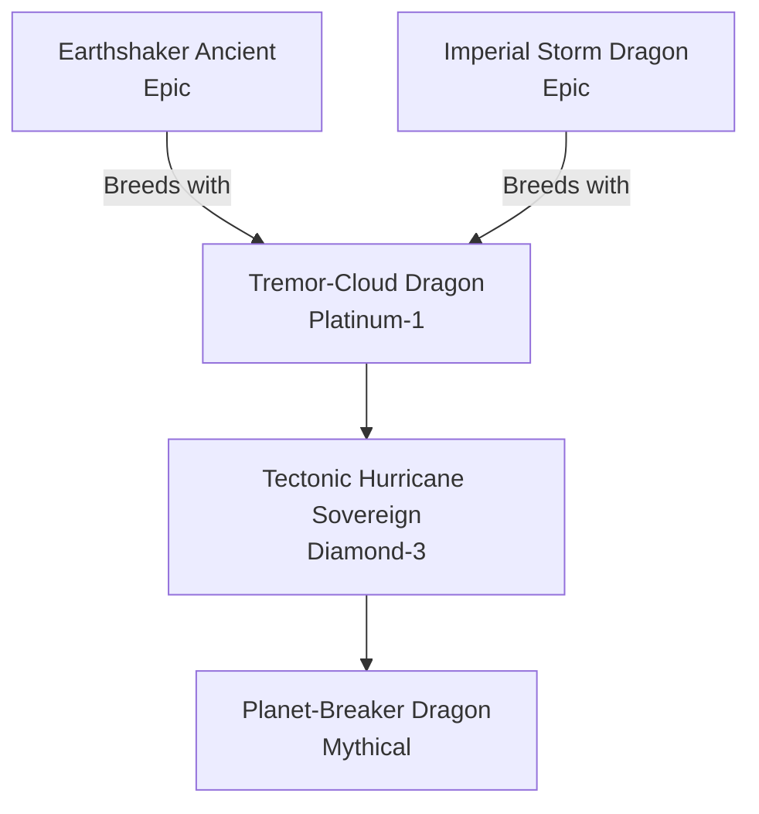

# Cataclysm / Terra-Storm Family (Hybrid)

## Summary
> [!abstract]
> This is a high-tier hybridization. When a Diamond-tier Earth dragon and an Epic Storm dragon cross, the result is a Cataclysm. They control planetary tectonics and global weather simultaneously.

## Ancestry & Origins
**Breeding Recipe**: High-Tier Earth + High-Tier Storm. Extremely rare, usually signals the end of an era.

## Evolution Tree

## Evolutionary Ceilings
- **Natural Ceiling**: Diamond-3 (Tectonic Hurricane Sovereign)
- **Mutation Ceiling**: Mythical (Planet-Breaker Dragon)
- **Transcendent Ceiling**: Mythical
