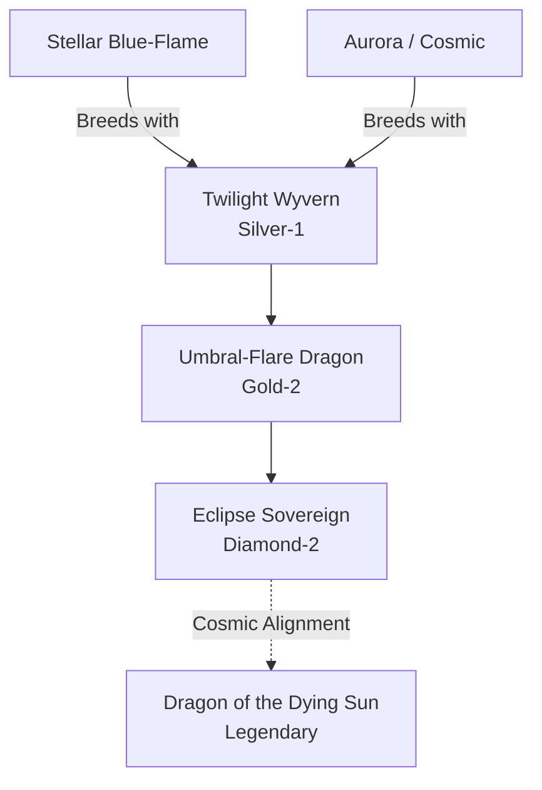

# Eclipse / Twilight Family (Hybrid)

## Summary
> [!abstract]
> A cosmic hybrid born from the impossible union of Noctis (Blue Flame/Darkness) and Aurora (Cosmic Light). They control the very concept of twilight and eclipses.

## Ancestry & Origins
**Breeding Recipe**: Noctis + Aurora. Usually occurs in the upper stratosphere during an actual solar or lunar eclipse.

## Evolution Tree

## Evolutionary Ceilings
- **Natural Ceiling**: Diamond-2 (Eclipse Sovereign)
- **Mutation Ceiling**: Legendary (Dragon of the Dying Sun)
- **Transcendent Ceiling**: Legendary
