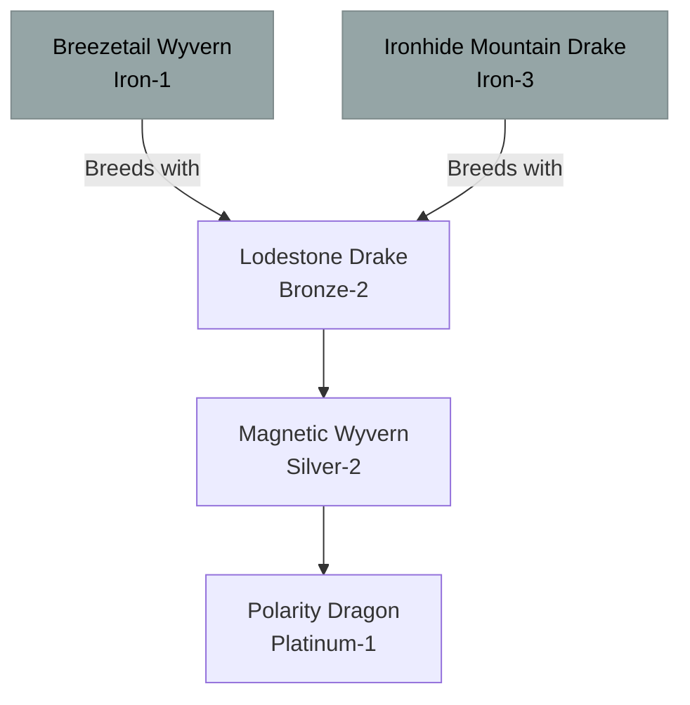

# Lodestone / Magnetism Family (Hybrid)

## Summary
> [!abstract]
> A hybrid family created by crossing Storm and Earth lineages. They utilize electromagnetic fields to levitate, crush armor, and deflect projectiles.

## Ancestry & Origins
**Breeding Recipe**: Storm (e.g., [[Breezetail Wyvern]]) + Earth (e.g., [[Ironhide Mountain Drake]]).
Highly sought after by military Tamers for their anti-cavalry and anti-siege capabilities.

## Typical Affinities
Lightning, Earth, Magnetism.

## Body Type Trends
Wyverns and True Dragons with dense, metallic scales arranged in conductive geometric patterns.

## Evolution Tree

## Branch Explanations
This hybrid line is more stable than others, allowing it to reach the Platinum tier before its internal magnetic poles tear its core apart.

## Evolutionary Ceilings
- **Natural Ceiling**: Platinum-1 (Polarity Dragon)
- **Mutation Ceiling**: Platinum-1
- **Transcendent Ceiling**: Impossible
