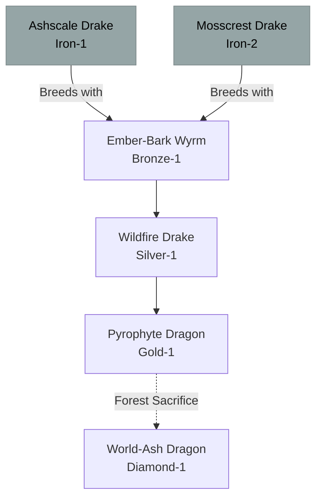

# Pyrophyte / Magma-Root Family (Hybrid)

## Summary
> [!abstract]
> A highly unstable, extremely destructive hybrid of Fire and Nature. They are creatures of burning wood, volcanic soil, and parasitic ash.

## Ancestry & Origins
**Breeding Recipe**: Fire (e.g., [[Ashscale Drake]]) + Nature (e.g., [[Mosscrest Drake]]).
In the wild, these are often considered invasive species and culled immediately, as they turn lush forests into burning, volcanic ash-lands where only they can survive.

## Typical Affinities
Fire, Nature (Corrupted/Ash).

## Body Type Trends
Wyrms and Drakes made of blackened, smoldering ironwood and obsidian.

## Evolution Tree

## Branch Explanations
Normally stops at Gold-1 as the internal fire eventually burns away the dragon's own wooden biology. However, if a Pyrophyte Dragon consumes the World-Tree or a forest of sufficient size, it can mutate into a World-Ash Dragon, stabilizing its form in pure carbon and diamond.

## Evolutionary Ceilings
- **Natural Ceiling**: Gold-1 (Pyrophyte Dragon)
- **Mutation Ceiling**: Diamond-1 (World-Ash Dragon)
- **Transcendent Ceiling**: Impossible
