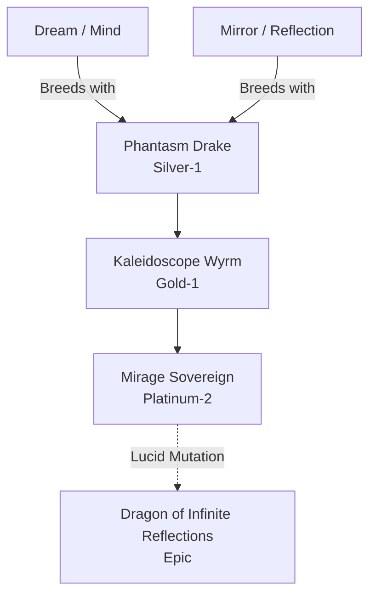

# Mirage / Dream-Glass Family (Hybrid)

## Summary
> [!abstract]
> A bizarre hybrid of Dream and Mirror elements. They do not fight physically; they reflect the deepest nightmares of their enemies into reality.

## Ancestry & Origins
**Breeding Recipe**: Dream + Mirror. 

## Evolution Tree

## Evolutionary Ceilings
- **Natural Ceiling**: Platinum-2 (Mirage Sovereign)
- **Mutation Ceiling**: Epic (Dragon of Infinite Reflections)
- **Transcendent Ceiling**: Epic
