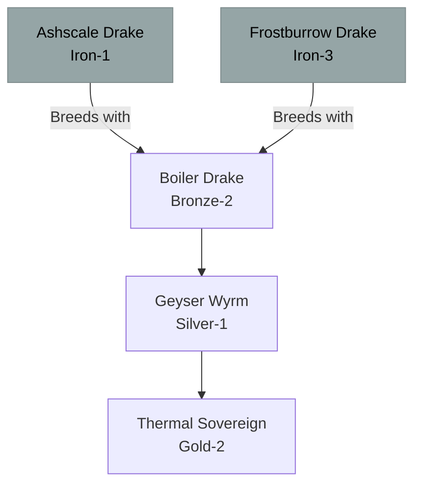

# Thermal / Steam Family (Hybrid)

## Summary
> [!abstract]
> A hybrid family created by crossing the Fire and Frost lineages. They exist in a constant state of internal boiling, venting scalding steam to regulate their temperature.

## Ancestry & Origins
**Breeding Recipe**: Fire (e.g., [[Ashscale Drake]]) + Frost (e.g., [[Frostburrow Drake]]).
Can occasionally occur naturally in volcanic regions that intersect with glacial permafrost.

## Typical Affinities
Fire, Ice, Steam/Water.

## Body Type Trends
Drakes and Wyrms. They usually possess heavily armored, boiler-like chests and lack wings, as they are too heavy and dense to fly.

## Evolution Tree

## Branch Explanations
As a hybrid, this family hits a hard genetic wall at the Gold tier. The conflicting Fire and Frost mana eventually equalize, preventing the dragon from generating the extreme internal friction needed to push into Platinum.

## Evolutionary Ceilings
- **Natural Ceiling**: Gold-2 (Thermal Sovereign)
- **Mutation Ceiling**: Gold-2
- **Transcendent Ceiling**: Impossible
