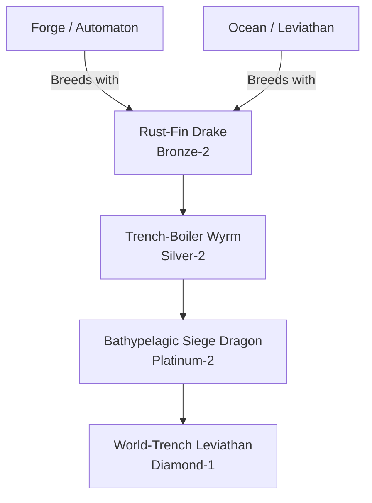

# Trench / Abyssal Forge Family (Hybrid)

## Summary
> [!abstract]
> Iron and ocean combine to create living, heavily armored submarines. They survive at depths that would crush normal ocean dragons, utilizing geothermal vents.

## Ancestry & Origins
**Breeding Recipe**: Forge + Ocean. 

## Evolution Tree

## Evolutionary Ceilings
- **Natural Ceiling**: Platinum-2 (Bathypelagic Siege Dragon)
- **Mutation Ceiling**: Diamond-1 (World-Trench Leviathan)
- **Transcendent Ceiling**: Diamond-1
