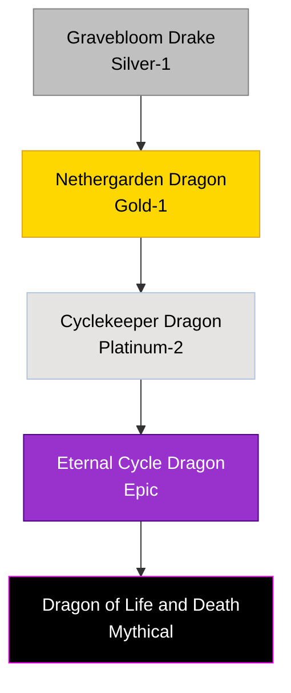

# Life / Death Duality Family

## Summary
> [!abstract]
> One of the few biologically stable lineages that straddles the line between absolute vitality and utter decay, maintaining perfect equilibrium.

## Ancestry & Origins
Nature lineages that adapted to regions flooded with necrotic mana, learning to metabolize both rather than being corrupted.

## Typical Affinities
Nature, Death, Life, Soul.

## Body Type Trends
Often appear as Drakes or True Dragons covered in both vibrant blooming flora and decaying, necrotic matter or exposed bone.

## Evolution Tree

## Failure Conditions
If the equilibrium breaks, the dragon will violently mutate or die. Overwhelming Life mana causes cancer-like explosive growth; overwhelming Death mana results in zombification and rot.

## Evolutionary Ceilings
- **Natural Ceiling**: Platinum-2 (Cyclekeeper)
- **Mutation Ceiling**: Epic (Eternal Cycle)
- **Transcendent Ceiling**: Mythical
