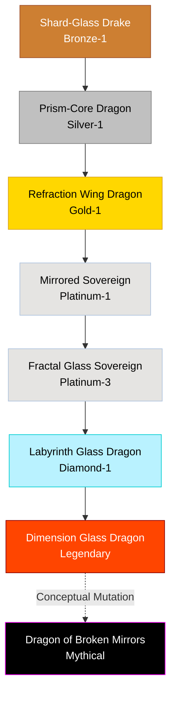

# Mirror / Reflection Family

## Summary
> [!abstract]
> A subterranean lineage possessing perfectly flat, highly polished crystalline scales capable of refracting light, magic, and eventually spatial dimensions.

## Ancestry & Origins
Evolved in extreme subterranean crystal caverns, adapting to an environment where light is scarce and magical reflection is the ultimate defense.

## Typical Affinities
Crystal, Light, Illusion, Space, Magic.

## Body Type Trends
Sleek, angular True Dragons and Wyrms. They move with strange, staccato movements, reflecting their environment so perfectly they often appear invisible.

## Evolution Tree

## Branch Explanations
As they evolve, their ability to reflect physical light turns into the ability to reflect *magic*, and finally, the ability to reflect *space* itself, creating endless dimensional labyrinths.

## Evolutionary Ceilings
- **Natural Ceiling**: Platinum-3 (Fractal Glass Sovereign)
- **Mutation Ceiling**: Diamond-1 (Labyrinth Glass)
- **Transcendent Ceiling**: Mythical (Dragon of Broken Mirrors)
