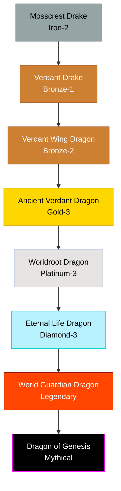

# Nature / Guardian Family

## Summary
> [!abstract]
> Benevolent or fiercely territorial ecosystem stabilizers. They transition from simple herbivores into conceptual anchors of life.

## Ancestry & Origins
Rooted in ancient forests and ley-line intersections, drawing mana from the flora rather than hunting.

## Typical Affinities
Nature, Earth, Wind, Life, Protection.

## Body Type Trends
Drakes to True Dragons, culminating in massive Worldroot Dragons that are physically anchored to the terrain they protect.

## Evolution Tree

## Evolutionary Ceilings
- **Natural Ceiling**: Platinum-3 (Worldroot Dragon)
- **Mutation Ceiling**: Legendary (World Guardian Dragon)
- **Transcendent Ceiling**: Mythical
