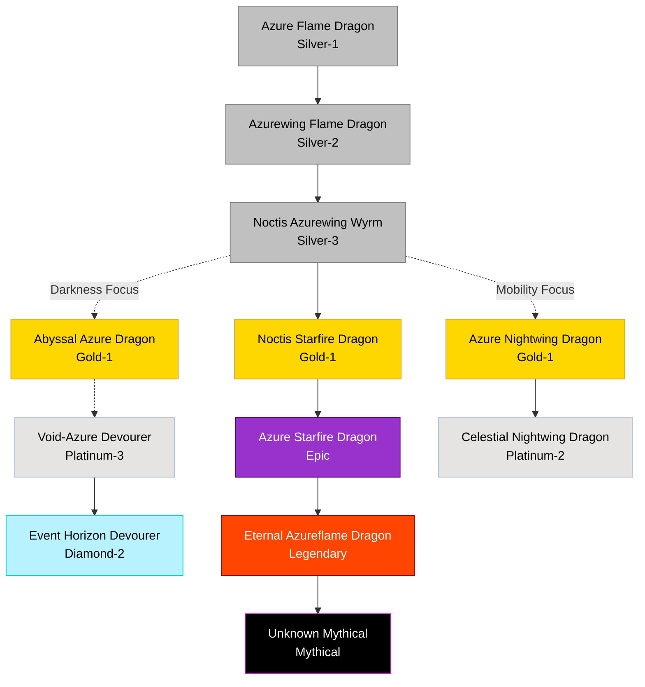

# Noctis / Stellar Blue-Flame Family

## Summary
> [!abstract]
> A highly specialized, rare nocturnal lineage defined by intense blue flames, unparalleled aerial acceleration, and a powerful resonance with starlight and darkness.

## Ancestry & Origins
An offshoot of standard fire lineages that adapted to nocturnal hunting, eventually unlocking stellar connections.

## Typical Affinities
Blue Flame, Wind, Darkness. The apex branches heavily into Stellar and Astral affinities.

## Body Type Trends
True Dragons and Wyrms. Known for sleek, aerodynamic builds and visual "mantles" of starfire or shadow.

## The Night / Trial Dragon Connection
> [!info] 
> This is the evolutionary family of **Night**, Rayne's Phantom Trial Dragon.

## Evolution Tree

## Branch Explanations

### Noctis Azurewing Wyrm (Silver-3)
Night's current species. Capable of aerial acceleration, Night Veil, and utilizing Azure Flame Orbs.

### Noctis Starfire Dragon (Gold-1)
The balanced Starfire path. Requires the stabilization of Blue Flame, Darkness, and Starlight. Extremely dangerous affinity balancing act.

### Abyssal Azure Dragon (Gold-1)
A mutation branch where Darkness consumes the Starlight potential, turning the dragon into a mana-burning abyss predator.

## Evolutionary Ceilings
- **Natural Ceiling**: Gold-1 (Azure Nightwing)
- **Mutation Ceiling**: Diamond-2 (Event Horizon Devourer)
- **Transcendent Ceiling**: Mythical (Unknown)

## Tamer Mechanics: Evolving Night
To reach **Noctis Starfire Dragon**, Night requires:
- Five separate nights of Moon Essence exposure.
- Compatible Starfire, Darkness, and Blue Flame resources.
- High Bloodline Purity.
- A specific evolution catalyst.
- Extreme Tamer oversight to prevent Starlight dominance or Darkness collapse.
