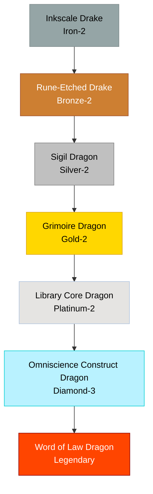

# Rune / Alchemy Family

## Summary
> [!abstract]
> A synthetic or hyper-cultivated lineage, originating from ancient draconic alchemists or Tamers attempting to write magic directly onto a dragon's bones.

## Ancestry & Origins
Not a naturally occurring wild lineage. Began as heavily modified Drakes with mana-circuits etched into their scales.

## Typical Affinities
Magic, Crystal, Earth, Metal.

## Body Type Trends
Drakes, transitioning into Construct Dragons and Mirror Dragons.

## Evolution Tree

## Evolutionary Ceilings
- **Natural Ceiling**: Silver-2 (Sigil Dragon) - requires constant Tamer upkeep to go higher.
- **Mutation Ceiling**: Diamond-3 (Omniscience Construct)
- **Transcendent Ceiling**: Legendary (Word of Law Dragon)
