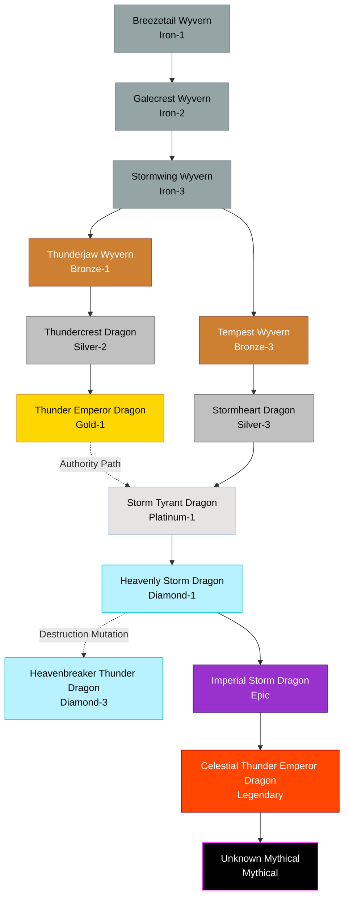

# Storm / Lightning Family

## Summary
> [!abstract]
> Apex predators of the sky, evolving from fragile gliders into regional weather dominators and conceptual thunder entities.

## Ancestry & Origins
Born from the friction of the sky.

## Typical Affinities
Wind, Lightning. High tiers unlock Authority, Destruction, Light, and Space.

## Body Type Trends
Begins exclusively as Wyverns (two legs, wing-arms) built for aerodynamics. Mid-tiers branch into True Dragons. Apex forms are Tyrant Dragons and Heavenly Dragons.

## Evolution Tree

## Evolutionary Ceilings (Base Lineage)
- **Natural Ceiling**: Silver-3 / Gold-1
- **Mutation Ceiling**: Diamond-3 (Heavenbreaker)
- **Transcendent Ceiling**: Mythical (Unknown)
