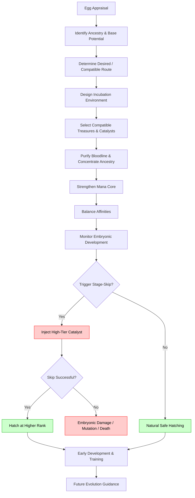

---
tags:
  - mechanics
  - eggs
  - dragon-tamer
---
# The Egg Engineering Loop

> [!abstract]
> A Dragon Tamer can influence an egg BEFORE it hatches. This is known as **Bloodline Cultivation** or **Egg Refinement**. 

A Tamer can influence embryonic vitality, mana-core density, affinity strength, scale/bone quality, mutation probability, and most importantly, they can induce **Evolution Stage-Skipping** and **Potential Enhancement**.

## Stage-Skipping
A Tamer may deliberately cause an expected Iron-1 hatchling to hatch directly as an Iron-2 or even Bronze-1. The farther the skip, the harder, more expensive, and more dangerous it is.

## Potential Enhancement
Improving a dragon's **future** potential. 
Example: An egg with a Natural Ceiling of Silver-1 can be cultivated to have a Natural Ceiling of Silver-3, a Mutation Ceiling of Gold-1, and a Transcendent Ceiling of Gold-3. This requires rare resources, compatible ancestry, specialized environments, and immense Tamer skill.

## The Cultivation Process

## Failure Conditions

Tamer enhancement is never perfectly safe. Potential failures include:
- Bloodline instability or affinity conflict.
- Mana-core fracture.
- Stage-skip failure (resulting in stillbirth or crippling).
- Premature hatching (loss of future evolutionary branches).
- Over-purification imbalance (erasing useful secondary traits).
- Resource rejection.
