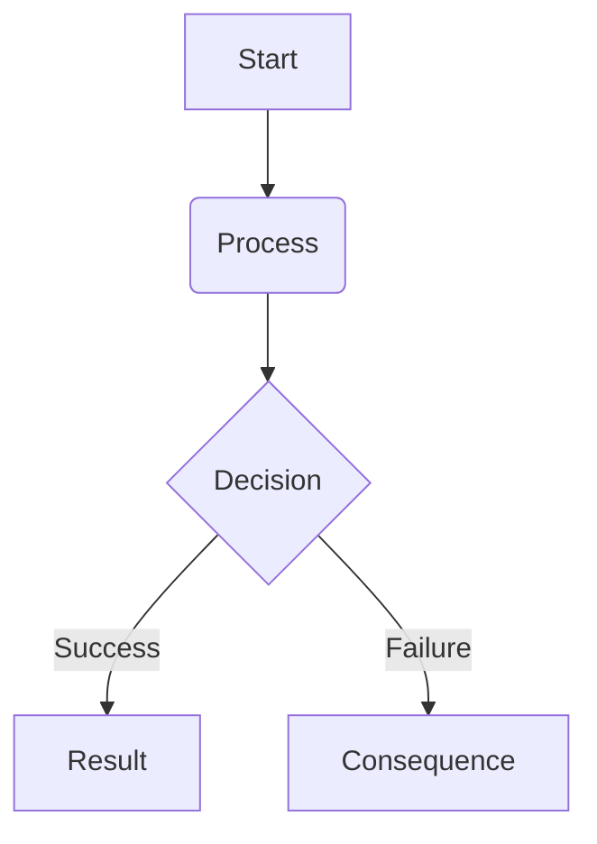

# {{system_name}}

## Overview
> [!rule]
> Core definition of the mechanic and how a Dragon Tamer utilizes it.

## Mechanism
Step-by-step explanation of how the system works in practice.

## Requirements
What a Tamer needs to utilize this mechanic (Rank, mana, resources, environment).

## Rayne's Application (SS-3)
How Rayne's SS-3 Dragon Tamer class interacts with this mechanic specifically, and what unique advantages it provides.

## Failure Conditions
> [!warning]
> Risks associated with failure, miscalculation, or poor execution.

## Flowchart

## Story Utility
How this mechanic can drive narrative, conflict, or character progression.
